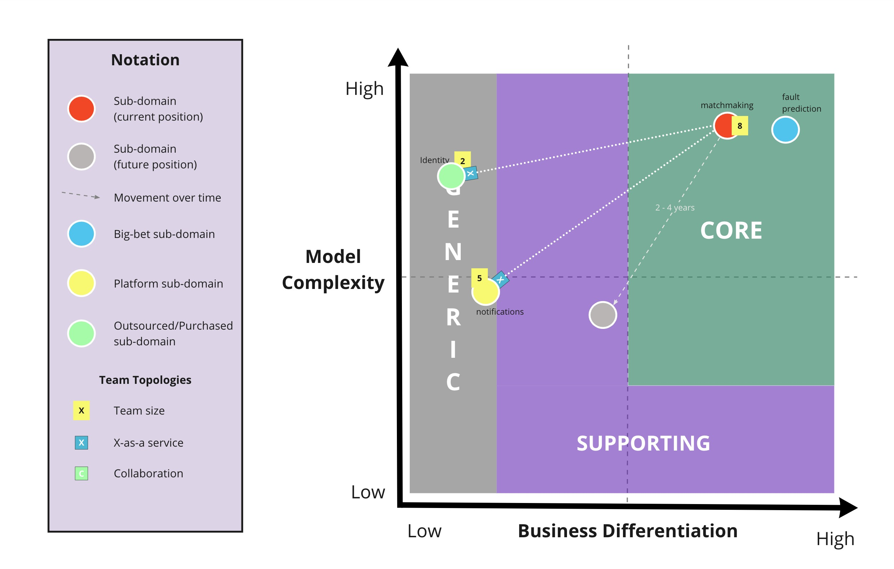
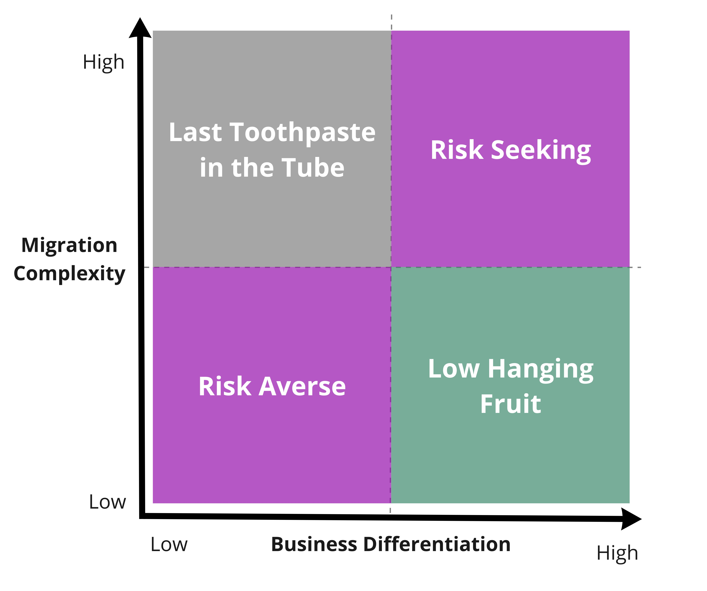

# Core Domain Charts

> **Nota sobre os elementos visuais:** os diagramas desta tradução reutilizam os recursos originais em inglês. Na primeira ocorrência de um rótulo visual, o termo original é apresentado entre parênteses para facilitar sua identificação nas imagens.

Os Core Domain Charts ajudam a visualizar a importância estratégica de cada (sub)domínio ou capacidade de negócio na arquitetura, permitindo tomar decisões arquiteturais alinhadas ao modelo de negócios.

Os [domínios principais (*Core Domains*)](https://www.youtube.com/watch?v=PBRluTD5oHo) são as partes do domínio nas quais se espera o maior [retorno sobre o investimento (ROI)](https://www.investopedia.com/terms/r/returnoninvestment.asp) e que, portanto, merecem maior atenção.

O verdadeiro poder desta técnica está nas conversas que ela provoca, especialmente entre diferentes disciplinas. Engenheiros podem avaliar a complexidade, enquanto responsáveis pelo produto e outras partes interessadas do negócio ajudam a determinar a diferenciação de negócio.

## Como usar

Há diversas maneiras de utilizar um Core Domain Chart, mas é importante não tentar representar todas as informações possíveis em um único diagrama. A seguir são apresentadas diferentes versões, cada uma adequada a tipos específicos de informação.

### Portfólio de (sub)domínios e contextos delimitados (*Bounded Contexts*)

Esta é a variação mais simples. Posicione cada (sub)domínio ou contexto delimitado no gráfico para obter uma visão relativa da posição de cada um em comparação com os demais.

### Mapa de Contextos com Team Topologies

Você pode complementar seus Core Domain Charts com as dependências entre os contextos delimitados e com o tipo de modo de interação definido pelo [Team Topologies](https://github.com/TeamTopologies).

### Migração da arquitetura

Com um pequeno ajuste no rótulo do eixo vertical, os Core Domain Charts podem ser usados para planejar a ordem de migração da arquitetura atual para a arquitetura-alvo.

## Sugestões para avaliar complexidade e diferenciação

Avaliar a complexidade do modelo (*Model Complexity*) e a diferenciação de negócio (*Business Differentiation*) dos domínios é difícil e, em geral, bastante subjetivo. Estratégia é uma aposta no futuro; por isso, nunca é possível saber com certeza o grau de complexidade ou diferenciação que algo alcançará. Ainda assim, discutir e visualizar as percepções sobre a complexidade e a diferenciação de cada domínio gera muito valor.

As perguntas a seguir podem ajudar a avaliar a complexidade e a diferenciação de cada domínio:

- Qual é a dificuldade de projetar um modelo conceitual para o domínio e construí-lo, além de mantê-lo, como software? Essa é a complexidade essencial do domínio (*essential domain complexity*).
- A solução técnica atual é mais complexa do que o necessário para oferecer a funcionalidade existente? Essa é a complexidade técnica acidental (*accidental technical complexity*).
- Existem processos, cálculos ou decisões complexas ocorrendo fora do software? Essa é a complexidade operacional (*operational complexity*).
- Qual seria a dificuldade para uma nova empresa concorrente igualar ou superar essa capacidade?
- Qual seria a dificuldade para um concorrente já estabelecido igualar ou superar essa capacidade?
- Quanta vantagem o (sub)domínio oferece atualmente, considerando receita, marca ou engajamento?
- Quanta vantagem o (sub)domínio poderia oferecer no futuro, considerando receita, marca ou engajamento?
- Qual seria o impacto sobre a marca caso ocorressem falhas graves ou recorrentes nesse domínio?
- Em qual [domínio do Cynefin](https://cynefin.io/wiki/Cynefin_Domains) ele se encontra?

A complexidade pode se manifestar de diferentes formas. As perguntas abaixo ajudam a identificar a complexidade essencial do domínio, a complexidade técnica acidental e a complexidade operacional de cada (sub)domínio:

- Qual é a dificuldade de descobrir novas fontes potenciais de valor?
- Qual é a dificuldade de projetar as regras, a lógica e os fluxos de trabalho que geram valor?
- Em que escala o sistema precisa operar? Mesmo quando as regras são simples, a escala pode acrescentar muita complexidade.
- São necessários níveis muito altos de diferenciação ou complexidade para superar líderes de mercado ou competir em mercados saturados?
- É necessário conhecimento especializado, difícil e caro de adquirir, para descobrir ou entregar valor?
- Quanto tempo uma pessoa recém-chegada leva para adquirir o conhecimento necessário e trabalhar com eficiência?

## Exemplos

Consulte os exemplos traduzidos para compreender melhor esses gráficos:

- [First-to-Market Core](examples/first-to-market-core.md)
- [Pioneiros realizam experimentos (*Pioneers Run Experiments*)](examples/pioneers-run-experiments.md)

Sinta-se à vontade para criar um pull request com seus próprios exemplos.

## Recursos adicionais

- [Como usar o template do Core Domain Chart no Draw.io](resources/drawio-template/readme.md)
- [Core Domain Patterns](https://medium.com/nick-tune-tech-strategy-blog/core-domain-patterns-941f89446af5)
- [Visualising Sociotechnical Architecture with DDD and Team Topologies](https://medium.com/nick-tune-tech-strategy-blog/visualising-sociotechnical-architecture-with-ddd-and-team-topologies-48c6be036c40)
- Uma ferramenta alternativa e complementar para avaliar a complexidade de processos é o [Process Automation Map](https://blog.bernd-ruecker.com/exploring-the-process-automation-map-7d9aa181a747), de [Bernd Rücker](https://twitter.com/berndruecker).

## Colaboradores

Agradecemos a todos os [colaboradores atuais e futuros](https://github.com/ddd-crew/core-domain-charts/graphs/contributors) e a [Eduardo da Silva](https://twitter.com/emgsilva), que contribuiu para o Core Domain Chart.

O Core Domain Chart foi fortemente inspirado por:

- [Wardley Mapping](https://medium.com/wardleymaps)
- [Team Topologies](https://teamtopologies.com/)

## Contribuições, dúvidas e feedback

O Core Domain Chart está disponível gratuitamente para uso. Comentários e ideias para aprimorá-lo ou criar novas versões também são bem-vindos.

Em caso de dúvidas, entre em contato com os mantenedores ou abra uma [issue](https://github.com/ddd-crew/core-domain-charts/issues/new/choose).

Você também pode enviar um pull request com seus próprios exemplos.

[![CC BY 4.0][cc-by-shield]][cc-by]

Este trabalho está licenciado sob a [Licença Internacional Creative Commons Atribuição 4.0][cc-by].

[![CC BY 4.0][cc-by-image]][cc-by]

[cc-by]: http://creativecommons.org/licenses/by/4.0/
[cc-by-image]: https://i.creativecommons.org/l/by/4.0/88x31.png
[cc-by-shield]: https://img.shields.io/badge/License-CC%20BY%204.0-lightgrey.svg
