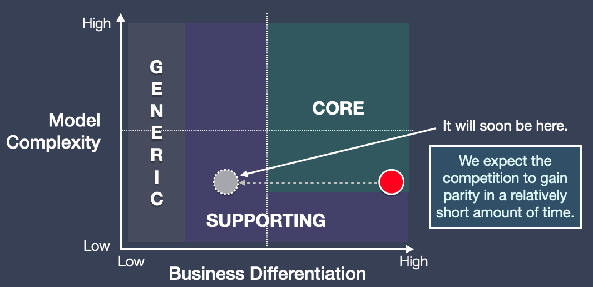

# First-to-Market Core

> **Nota:** a imagem deste exemplo permanece em inglês. O nome do padrão é mantido no idioma original para preservar a correspondência com o recurso visual e com a literatura relacionada.

Um **First-to-Market Core** — domínio principal obtido por chegar primeiro ao mercado — oferece uma vantagem à organização que desenvolve determinada capacidade antes das concorrentes. Entretanto, como a complexidade dessa funcionalidade é baixa e a vantagem não é fácil de defender, a concorrência logo conseguirá alcançá-la. Por isso, essa capacidade não permanecerá como domínio principal por muito tempo.

## Mentalidade de engenharia

Ao identificar um First-to-Market Core, reconheça que ele é prioritário no momento, mas avalie com cuidado quanto esforço deve ser investido na arquitetura e no desenvolvimento dessa capacidade. Como ela não permanecerá para sempre como domínio principal, é importante pensar antecipadamente em qual poderá ser o próximo Core Domain.

## Exemplo

Nos primeiros anos do streaming comercial e do download de músicas, o principal diferencial era oferecer um catálogo com os artistas mais conhecidos do mundo. Negociar direitos com gravadoras e importar suas músicas em diferentes formatos era essencial e consumia muito tempo, embora não representasse um desafio de engenharia particularmente complexo.

Ao longo de alguns anos, a maioria das plataformas passou a oferecer os principais artistas em seus catálogos. O domínio principal tornou-se, então, a descoberta de conteúdo: recomendações e sugestões que ajudassem as pessoas a encontrar mais rapidamente músicas relevantes para elas.
