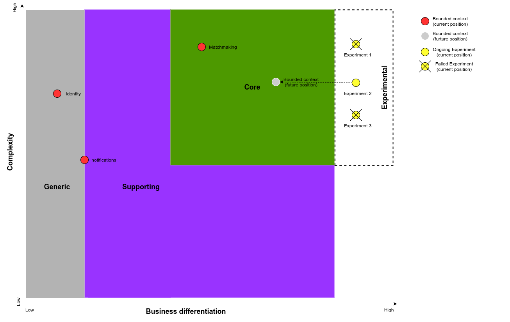

# Pioneiros realizam experimentos (*Pioneers Run Experiments*)

> **Nota:** a imagem deste exemplo permanece em inglês. Os rótulos visuais originais são preservados entre parênteses quando necessário.

Caso sua empresa siga o conceito **Pioneers, Settlers and Town Planners** — pioneiros, colonizadores e urbanistas — definido por Simon Wardley, consulte [Wardley Maps — Chapter 4](https://medium.com/wardleymaps/doctrine-8bb0015688e5). Nesse caso, pode ser útil adicionar uma área **experimental (*Experimental*)** ao lado da área de domínio principal (**Core**). Esses experimentos são conduzidos por equipes dedicadas de pioneiros ou de inovação, com o objetivo de identificar a próxima grande fonte de diferenciação para o negócio.

## Mentalidade de engenharia

> Pioneiros são pessoas brilhantes. Eles conseguem explorar conceitos nunca antes descobertos e territórios ainda não mapeados. Produzem resultados surpreendentes, mas também falham com frequência. Em muitos casos, aquilo que constroem não funciona adequadamente e ainda não inspira confiança. Eles criam ideias consideradas “malucas”. Esse tipo de inovação é o que descrevemos como pesquisa fundamental. São os pioneiros que tornam possível o sucesso futuro.

Ainda assim, o trabalho dos pioneiros envolve apostas. O ideal é fornecer um orçamento e um período definidos. Muitos experimentos falharão, mas, quando uma ideia promissora for identificada, os colonizadores (*settlers*) deverão assumir o trabalho e transformá-la em um produto: o próximo **domínio principal (*Core Domain*)**.

Não confunda o trabalho dos pioneiros com experimentos realizados dentro de contextos classificados como **Core**, **Supporting** ou **Generic**. Esses experimentos podem ser representados [sem a utilização de uma área experimental](https://github.com/ddd-crew/core-domain-charts/issues/8#issuecomment-647022070).

## Exemplo

Uma fabricante do setor de moda está digitalizando seus processos de vendas B2B, transferindo sua operação presencial para showrooms digitais e uma plataforma de pedidos on-line.

A empresa formou uma equipe multifuncional, com mentalidade ágil, para trabalhar na nova plataforma. Ao mesmo tempo, selecionou um pequeno grupo de pessoas para compor uma equipe de inovação.

A equipe de inovação não participa das atividades operacionais. Ela possui orçamento fixo para executar um conjunto de experimentos voltados à melhoria da experiência dos clientes nos showrooms digitais.

Os experimentos variam desde a produção de vídeos de moda para novas coleções até a renderização 3D de novos designs. A empresa pretende ir além de uma solução simples de comércio eletrônico, pois seus clientes B2B estão acostumados a conhecer os novos designs presencialmente, em um showroom, antes de fazer seus pedidos.

O setor da moda muda rapidamente, com novas coleções produzidas todos os meses. Portanto, uma possível solução precisa ser barata e rápida o suficiente para acompanhar produtos que mudam constantemente.

Seria arriscado demais executar esses experimentos dentro da equipe responsável pelo domínio principal. Essa equipe precisa se concentrar na construção de um sistema escalável e de alta qualidade. A equipe de inovação, por outro lado, possui liberdade para experimentar por tentativa e erro até encontrar uma solução funcional que possa ser integrada à plataforma principal de pedidos.

## Saiba mais

Uma discussão detalhada sobre o uso de uma área experimental em comparação com outras formas de visualização está disponível na [issue relacionada](https://github.com/ddd-crew/core-domain-charts/issues/8).
