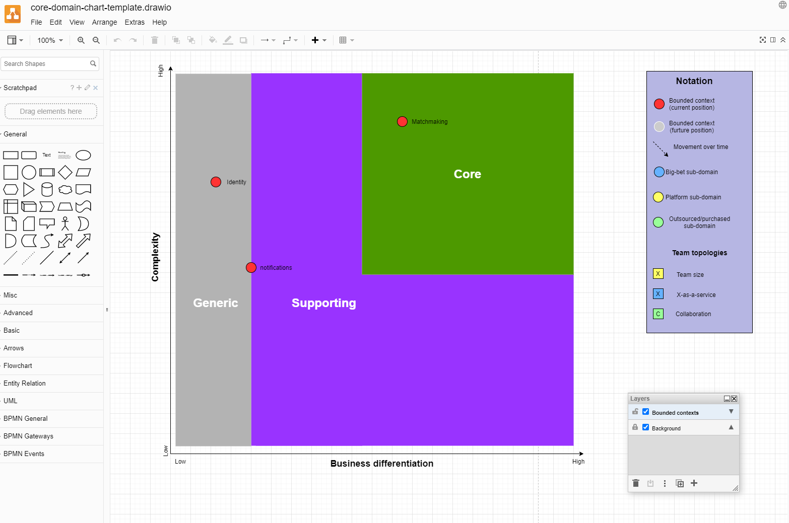

# Como usar o template do Core Domain Chart no Draw.io

> **Nota:** o arquivo editável e a interface ilustrada permanecem em inglês. Os nomes originais dos controles, das camadas e das caixas são mantidos abaixo para facilitar sua localização na ferramenta.

## Uso básico do Draw.io

- Faça o clone deste repositório.
- Acesse o [Draw.io](https://www.diagrams.net/) ou instale o aplicativo Draw.io para desktop.
- Clique em `Open Existing Diagram` (`Abrir diagrama existente`).
- Selecione o template `core-domain-chart-template.drawio`.
- Verifique se a camada `Bounded contexts` (`Contextos delimitados`) está ativada e desbloqueada.
- Copie os ícones da caixa `Notation` (`Notação`) e posicione-os no Core Domain Chart conforme necessário.
